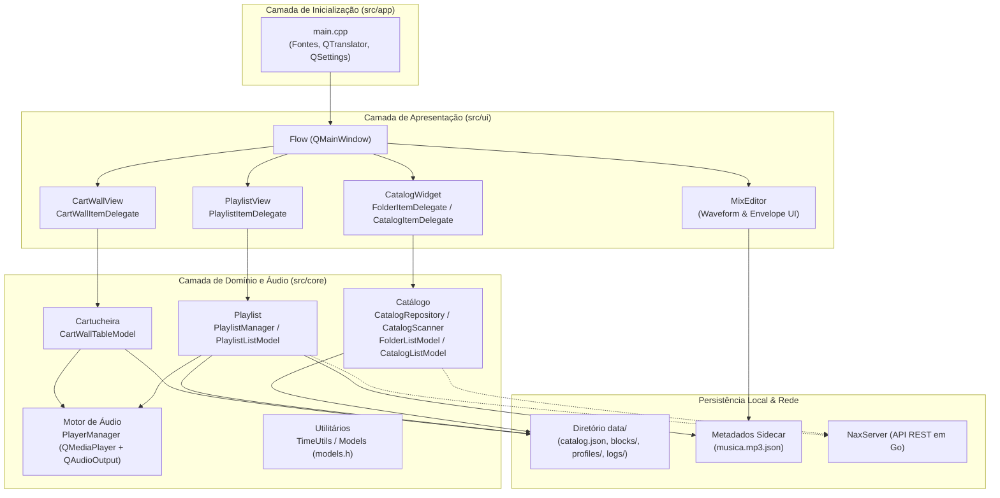

# Visão Geral da Arquitetura

O **NaxStudio Flow** foi projetado com uma arquitetura modular em camadas sobre o framework **Qt 6 (C++17)**, separando estritamente a lógica de negócio, modelos de dados e controle de áudio (`src/core`) da camada de apresentação visual (`src/ui`).

---

## 🏛️ Diagrama de Camadas



---

## 📦 Responsabilidades de Cada Diretório em `src/`

### 1. `src/app/` - Ponto de Entrada
- Contém [`main.cpp`](../../src/app/main.cpp) e o `CMakeLists.txt` que declara o executável `flow`.
- Responsável por:
  - Inicializar o `QApplication` e o ícone global da janela.
  - Carregar a família tipográfica **Roboto** embutida nos recursos (`.qrc`) e ativar a *feature* OpenType `tnum` (números tabulares de largura fixa, essenciais para cronômetros que mudam a cada milissegundo sem causar trepidação no texto).
  - Ler o idioma configurado no `QSettings("NaxStudio", "Flow")` (ou detectar o locale do sistema operacional) e instalar o `QTranslator` correspondente (`:/lang/<locale>.qm`).
  - Instanciar e exibir a janela principal `Flow` maximizada.

### 2. `src/core/` - Núcleo de Dados, Regras de Negócio e Áudio
- **Regra Arquitetural Fundamental**: Nenhum arquivo em `src/core/` pode depender de `src/ui/` ou de componentes visuais (`QWidget`, `QPainter`, `QStyle`).
- Contém:
  - [`models.h`](../../src/core/models.h): Estruturas centrais (`PlaylistItem`), enums de domínio (`MediaType`, `ItemType`, `BlockType`, `PlaylistStatus`, `PlaylistItemStatus`) e *Roles* (`PlaylistItemRoles`).
  - `catalog/`: Repositório de leitura de JSON (`CatalogRepository`), scanner multithread assíncrono (`CatalogScanner` e `CatalogScannerWorker`) e modelos de lista (`FolderListModel` e `CatalogListModel`).
  - `playlist/`: Gerenciador de execução contínua (`PlaylistManager`), modelo de dados e cálculo de blocos (`PlaylistListModel`) e controle individual de reprodução/fade (`player/PlayerManager`).
  - `cartwall/`: Estrutura de slot (`CartItem`) e modelo tabular linear mapeado em grade (`CartWallTableModel`).
  - `utils/`: Funções puras de formatação de tempo (`TimeUtils`).

### 3. `src/ui/` - Interface Gráfica (Views, Delegates e Docks)
- Contém a janela principal [`Flow`](../../src/ui/Flow.h) e a subpasta `widgets/`.
- Adota o padrão **Model/View/Delegate** do Qt para todas as listas e grades:
  - **Views (`PlaylistView`, `CartWallView`, `QListView`)**: Tratam eventos de mouse, seleção, cursores, redimensionamento de células e eventos de *Drag-and-Drop* (incluindo o desenho de indicadores visuais de inserção).
  - **Delegates (`PlaylistItemDelegate`, `CartWallItemDelegate`, `CatalogItemDelegate`, `FolderItemDelegate`)**: Herdam de `QStyledItemDelegate` e realizam toda a pintura customizada (`paint()`) diretamente com `QPainter`, sem instanciar `QWidgets` filhos para cada linha ou célula.

### 4. `src/resources/` e `src/lang/`
- `src/resources/`: Armazena todos os ícones vetoriais (`.svg`), ícones de categoria de mídia (`music.svg`, `jingle.svg`, `commercial.svg`, `other.svg`), fontes `Roboto` e o arquivo de recursos `app.qrc`.
- `src/lang/`: Armazena os arquivos de tradução `.ts` (`pt_BR.ts`, `en_US.ts`) que são compilados pelo `qt_add_translations` em arquivos binários `.qm` embutidos no executável sob o prefixo `:/lang`.

---

## 🗂️ Estrutura de Instalação e Diretório `data/`

Em ambiente de produção, a instalação do NaxStudio Flow é auto-contida e segue a separação entre binários e dados de operação:

```text
Flow/
├── bin/                      # Executável principal (flow / flow.exe), DLLs/SOs e plugins Qt
└── data/                     # Diretório raiz de persistência local
    ├── catalog.json          # Espelho local das pastas do catálogo e mapeamento de paths
    ├── blocks/               # Arquivos de blocos de programação salvos localmente
    ├── profiles/             # Arquivos JSON de cada perfil (permissões + cartucheira)
    ├── logs/                 # Histórico detalhado de reprodução (auditoria/ECAD)
    └── config/               # Configurações locais da estação (placas de áudio, rede, etc.)
```

Essa organização permite fazer backup, migração ou atualização dos binários em `Flow/bin/` sem risco de sobrescrever as configurações, perfis, logs ou blocos locais em `Flow/data/`.

