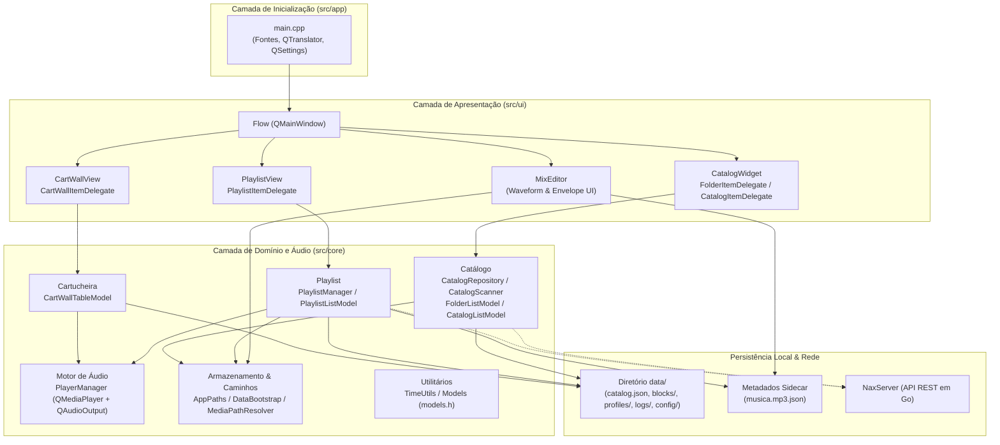

# Visão Geral da Arquitetura

O **NaxStudio Flow** foi projetado com uma arquitetura modular em camadas sobre o framework **Qt 6 (C++17)**, separando estritamente a lógica de negócio, modelos de dados e controle de áudio (`src/core`) da camada de apresentação visual (`src/ui`).

---

## 🏛️ Diagrama de Camadas



---

## 📦 Responsabilidades de Cada Diretório em `src/`

### 1. `src/app/` - Ponto de Entrada
- Contém [`main.cpp`](../../src/app/main.cpp) e o `CMakeLists.txt` que declara o executável `flow`.
- Responsável por:
  - Inicializar o `QApplication` e o ícone global da janela.
  - Carregar a família tipográfica **Roboto** embutida nos recursos (`.qrc`) e ativar a *feature* OpenType `tnum` (números tabulares de largura fixa, essenciais para cronômetros que mudam a cada milissegundo sem causar trepidação no texto).
  - Ler o idioma configurado no `QSettings("NaxStudio", "Flow")` (ou detectar o locale do sistema operacional) e instalar o `QTranslator` correspondente (`:/lang/<locale>.qm`).
  - Instanciar e exibir a janela principal `Flow` maximizada.

### 2. `src/core/` - Núcleo de Dados, Regras de Negócio e Áudio
- **Regra Arquitetural Fundamental**: Nenhum arquivo em `src/core/` pode depender de `src/ui/` ou de componentes visuais (`QWidget`, `QPainter`, `QStyle`).
- Contém:
  - [`models.h`](../../src/core/models.h): Estruturas centrais (`PlaylistItem`), enums de domínio (`MediaType`, `ItemType`, `BlockType`, `PlaylistStatus`, `PlaylistItemStatus`) e *Roles* (`PlaylistItemRoles`).
  - `catalog/`: Repositório de leitura de JSON (`CatalogRepository`), scanner multithread assíncrono (`CatalogScanner` e `CatalogScannerWorker`) e modelos de lista (`FolderListModel` e `CatalogListModel`).
  - `playlist/`: Gerenciador de execução contínua (`PlaylistManager`), modelo de dados e cálculo de blocos (`PlaylistListModel`) e controle individual de reprodução/fade (`player/PlayerManager`).
  - `cartwall/`: Estrutura de slot (`CartItem`) e modelo tabular linear mapeado em grade (`CartWallTableModel`).
  - `storage/`: Resolução portátil do diretório de dados (`AppPaths`), módulo de inicialização segura na primeira execução (`DataBootstrap`) e resolução em cascata de diretórios e arquivos de mídia entre caminho primário e espelhos locais (`MediaPathResolver`).
  - `utils/`: Funções puras de formatação de tempo (`TimeUtils`).

### 3. `src/ui/` - Interface Gráfica (Views, Delegates e Docks)
- Contém a janela principal [`Flow`](../../src/ui/Flow.h) e a subpasta `widgets/`.
- Adota o padrão **Model/View/Delegate** do Qt para todas as listas e grades:
  - **Views (`PlaylistView`, `CartWallView`, `QListView`)**: Tratam eventos de mouse, seleção, cursores, redimensionamento de células e eventos de *Drag-and-Drop* (incluindo o desenho de indicadores visuais de inserção).
  - **Delegates (`PlaylistItemDelegate`, `CartWallItemDelegate`, `CatalogItemDelegate`, `FolderItemDelegate`)**: Herdam de `QStyledItemDelegate` e realizam toda a pintura customizada (`paint()`) diretamente com `QPainter`, sem instanciar `QWidgets` filhos para cada linha ou célula.

### 4. `src/resources/` e `src/lang/`
- `src/resources/`: Armazena todos os ícones vetoriais (`.svg`), ícones de categoria de mídia (`music.svg`, `jingle.svg`, `commercial.svg`, `other.svg`), fontes `Roboto` e o arquivo de recursos `app.qrc`.
- `src/lang/`: Armazena os arquivos de tradução `.ts` (`pt_BR.ts`, `en_US.ts`) que são compilados pelo `qt_add_translations` em arquivos binários `.qm` embutidos no executável sob o prefixo `:/lang`.

---

## 🎨 Arquitetura Model/View/Delegate na Interface

Em uma emissora de rádio real, uma pasta de músicas no catálogo pode conter de **2.000 a 20.000 arquivos**, uma grade de playlist de 24 horas reúne **centenas de inserções e blocos**, e a cartucheira é redimensionada ou reordenada com frequência. Instanciar milhares de `QWidgets` individuais causaria alto consumo de memória, lentidão na troca de pastas, engasgos na rolagem (*scrolling*) e alto uso de CPU ao atualizar barras de progresso em tempo real.

Para garantir fluidez constante, todas as listas e grades do **NaxStudio Flow** utilizam a arquitetura **Model/View/Delegate** do Qt:

| Camada | Componentes Principais | Responsabilidade |
| :--- | :--- | :--- |
| **Models (`src/core/`)** | `CatalogListModel`, `FolderListModel`, `PlaylistListModel` (`QAbstractListModel`) e `CartWallTableModel` (`QAbstractTableModel`) | Armazenam dados e estado sem conhecer detalhes visuais, permitindo manipulação e testes independentes. |
| **Views (`src/ui/widgets/`)** | `QListView` (Catálogo), `PlaylistView` (`QListView`), `CartWallView` (`QTableView`) | Gerenciam rolagem, seleção, eventos de mouse, redimensionamento e *Drag-and-Drop*. |
| **Delegates (`src/ui/widgets/`)** | `CatalogItemDelegate`, `FolderItemDelegate`, `PlaylistItemDelegate`, `CartWallItemDelegate` (`QStyledItemDelegate`) | Desenham gradientes, cantos arredondados, barras de progresso com *clip path*, badges (`NO AR` / `PRÓXIMO`), ícones SVG e textos elidados sob demanda com `QPainter`. |

Essa separação traz três benefícios práticos:
- **Desempenho $O(1)$ na Renderização**: O Qt invoca `paint()` apenas para os itens visíveis no *viewport*, independentemente de a lista possuir 10 ou 50.000 itens.
- **Atualização Leve de Progresso**: Atualizar a posição de reprodução de uma faixa emite apenas `dataChanged(idx, idx, {PositionRole})`, repintando somente o retângulo daquele card.
- **Cache de Recursos no Delegate**: Para manter `paint()` e `sizeHint()` extremamente rápidos, fontes, ícones e pincéis de gradiente (`QBrush`) são pré-cacheados como membros da classe no construtor do delegate (veja detalhes em [Convenções de Código C++ e Qt](../conventions/coding-style.md#-boas-práticas-em-qstyleditemdelegate)).

---

## 🗂️ Estrutura de Instalação e Diretório `data/`

Em ambiente de produção (e nos pacotes portáteis gerados pelo GitHub Actions para Windows e Linux), a instalação do NaxStudio Flow é auto-contida e segue a separação estrita entre binários e dados de operação:

```text
Flow/
├── bin/                      # Executável principal (flow / flow.exe), libs/DLLs e plugins Qt
├── data/                     # Diretório raiz de persistência local (resolvido como ../data)
│   ├── catalog.json          # Catálogo local das pastas, comandos e mirror paths
│   ├── blocks/               # Arquivos de blocos de programação salvos localmente
│   ├── profiles/             # Arquivos JSON de cada perfil (permissões + cartucheira)
│   ├── logs/                 # Histórico detalhado de reprodução (auditoria/ECAD) e logs .txt
│   └── config/               # Configurações locais da estação (placas de áudio, rede, etc.)
└── COPYING                   # Licença GPLv3
```

### Resolução Dinâmica (`../data`) e Bootstrap na Primeira Inicialização (`AppPaths` + `DataBootstrap`)

1. **Resolução Relativa ao Binário**:
   - Por padrão, `AppPaths::resolveDataDir()` calcula dinamicamente `../data` a partir de `QCoreApplication::applicationDirPath()`, **sem gravar caminhos absolutos no `QSettings`**.
   - Isso mantém a pasta portátil 100% relocável em produção (`Flow/bin/flow.exe` → `Flow/data/`) e alinha exatamente com o fluxo de desenvolvimento local (`build/flow.exe` → `<repo>/data/`).
2. **Precedência de *Override***:
   - `NAXFLOW_DATA_DIR` (variável de ambiente): maior prioridade, útil para ambientes automatizados ou múltiplas instâncias.
   - `QSettings("NaxStudio", "Flow")` chave `"dataDir"`: *override* explícito opcional quando configurado. A chave legada `"db"` (`../db`) é ignorada.
   - Padrão portátil: `<applicationDirPath>/../data`.
3. **Bootstrap Seguro na Primeira Execução (`DataBootstrap::initialize()`)**:
   - Os pacotes distribuídos (`.zip` e `.tar.gz`) entregam `bin/`, uma pasta `data/` **vazia** (sem arquivos nem subpastas) e `COPYING`. Assim, se o usuário copiar os arquivos de uma atualização por cima de uma instalação existente, nenhum dado local em `data/` é sobrescrito.
   - Na inicialização do `Flow`, o módulo `DataBootstrap::initialize()` verifica e cria apenas as subpastas ausentes (`blocks/`, `profiles/`, `logs/`, `config/`) e gera um `data/catalog.json` mínimo (`version: 1` + pasta virtual `Comandos` com `Pausa`) **somente se o arquivo ainda não existir**.

Essa organização permite fazer backup, migração ou atualização dos binários em `Flow/bin/` (ou extrair um novo pacote sobre a pasta existente) sem risco de sobrescrever as configurações, perfis, logs ou blocos locais em `Flow/data/`.

