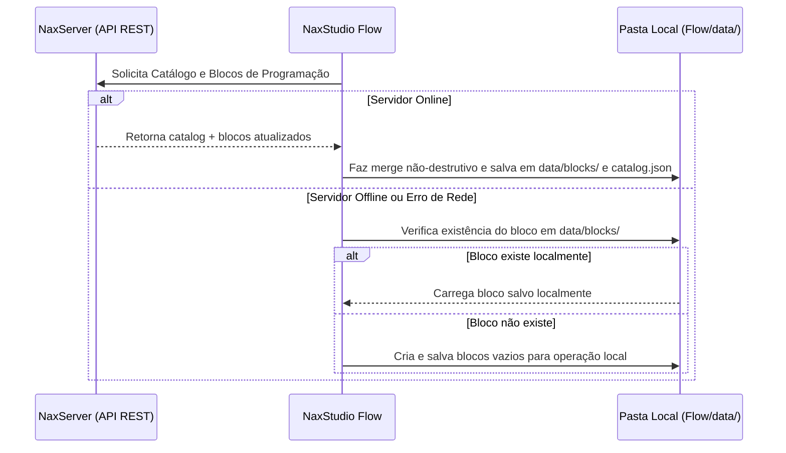
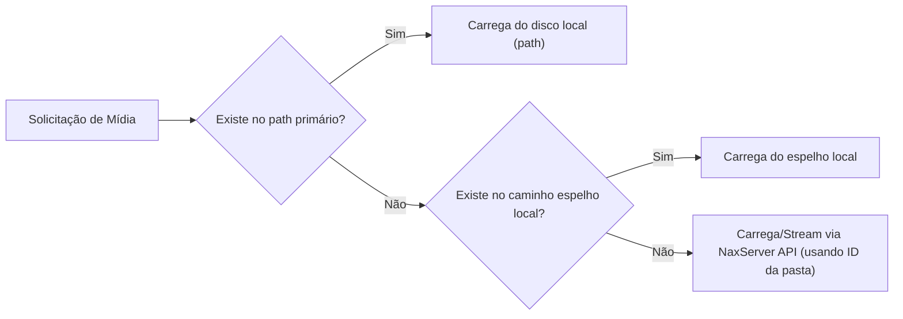

# Sincronização com NaxServer e Armazenamento Local

O **NaxStudio Flow** opera sob uma filosofia **Offline-First Híbrida**. Ele foi desenhado para integrar-se perfeitamente ao servidor de gerenciamento de emissora [**NaxServer**](https://github.com/BrunoCardosoFS/NaxServer), mas também para funcionar de forma **100% autônoma** caso o servidor caia, a rede local sofra interrupções ou a emissora opte por utilizá-lo sem servidor.

---

## 🔄 Dinâmica Servidor vs. Operação Local (`data/`)

### Regras Fundamentais de Sincronização de Blocos

1. **Espelhamento Local Contínuo**:
   - Conectado ou não ao `NaxServer`, o Flow sempre cria e mantém arquivos de programação locais em `Flow/data/blocks/`.
   - Tudo o que é recebido do servidor é imediatamente persistido localmente para garantir que uma queda de servidor no meio da programação seja imperceptível para a transmissão no ar.

2. **Isolamento das Edições Locais no Flow**:
   - Quando um locutor ou operador altera um bloco dentro do Flow (ex.: adiciona uma música extra, remove uma faixa ou reordena itens), essa alteração **não é enviada** de volta para o banco de dados do `NaxServer`. Ela é salva exclusivamente no arquivo local daquele computador (`data/blocks/`).

3. **Merge Não-Destrutivo ao Receber Atualizações do Servidor**:
   - Se o departamento comercial ou artístico atualizar um bloco no `NaxServer`, o Flow recebe a atualização e a aplica **preservando as modificações locais já feitas no estúdio**.
   - *Exemplo*: Se o operador inseriu manualmente uma música na posição 3 do bloco musical no Flow e o servidor enviou uma atualização daquele bloco, a música inserida localmente permanece naquela mesma posição, evitando quebras na programação ao vivo.

4. **Opção "Restaurar Bloco"**:
   - Caso o operador deseje descartar todas as modificações locais feitas em um bloco específico no Flow, existe a ação explícita de **Restaurar Bloco**, que apaga os overrides locais daquele bloco e força a ressincronização exata com o estado atual do `NaxServer`.

---

## 🎵 Resolução de Arquivos de Mídia em Cascata (Rede e Espelho Local)

O `NaxServer` também atua como servidor de arquivos na rede local, permitindo que qualquer computador na mesma rede execute o Flow sem precisar ter todo o acervo musical duplicado localmente. Ao mesmo tempo, computadores de estúdio principal podem manter um espelho local do acervo para máxima segurança.

### Estrutura das Pastas no `catalog.json`

Cada pasta cadastrada no `catalog.json` contém:
- `id`: Identificador único da pasta na API do `NaxServer`.
- `title`: Nome de exibição da pasta (ex.: `"Pop Nacional"`, `"Vinhetas Hora Certa"`).
- `path`: Caminho primário no sistema de arquivos.
- `mirrorPath` *(ou caminhos locais adicionais)*: Caminho alternativo configurável na máquina local caso o computador possua um espelho do acervo em outro disco/diretório.
- `type`: Categoria da mídia (`0 = Jingle`, `1 = Music`, `2 = Commercial`, `3 = Other`).

### Ordem de Busca ao Carregar uma Mídia

Quando o Flow precisa reproduzir ou analisar um arquivo de áudio pertencente a uma pasta do catálogo:

1. **1ª Tentativa (`path` primário)**: Verifica se o arquivo existe no caminho padrão configurado na pasta.
2. **2ª Tentativa (Caminho Espelho Local)**: Verifica se há um caminho local alternativo configurado para aquela pasta nesta máquina e se o arquivo existe lá.
3. **3ª Tentativa (`NaxServer` via Rede)**: Se não for encontrado localmente, busca o arquivo diretamente na API do `NaxServer` utilizando o `id` da pasta + identificador/nome do arquivo.

---

## 🎚️ Hierarquia de Metadados de Mixagem (`musica.mp3.json` vs. Inserção)

Os pontos de mixagem e automação de volume (`startPoint`, `endPoint`, `mixStart`, `mixEnd`, `fadeInEndPoint`, `fadeOutStartPoint` e envelopes de volume) possuem duas origens possíveis:

### 1. Metadados Específicos da Inserção (Maior Prioridade)
- Quando alguém prepara uma programação no `NaxServer` ou ajusta um item específico na Playlist do Flow, pode definir uma mixagem exclusiva para **aquela inserção** (por exemplo, fazer uma música terminar mais cedo apenas naquele bloco específico).
- Quando o operador escolhe **"Salvar somente para esta inserção"** no `MixEditor`, os dados ficam gravados apenas no registro daquela inserção dentro do bloco local da playlist.

### 2. Arquivo JSON Irmão / Sidecar Global (`musica.mp3.json`)
- Caso a inserção não possua metadados específicos preparados, o Flow utiliza os metadados globais daquela mídia.
- Toda mídia cadastrada possui um arquivo JSON irmão na mesma pasta, seguindo rigorosamente a convenção de nomenclatura:
  - Arquivo de áudio: `musica.mp3`
  - Arquivo de metadados irmão: `musica.mp3.json`
- Quando o operador escolhe **"Salvar globalmente"** no `MixEditor`, o Flow atualiza (ou cria) o arquivo `musica.mp3.json` ao lado do arquivo de áudio, tornando aquela mixagem o padrão para todas as futuras execuções daquela faixa.
- **Portabilidade**: Ao copiar uma pasta de músicas juntamente com seus arquivos `.mp3.json` para outro computador ou backup, toda a mixagem acompanha os arquivos sem depender de banco de dados externo, funcionando tanto conectado quanto em modo 100% offline.

---

## 👤 Escopo de Armazenamento dos Perfis e Cartucheira

Diferente do catálogo e da grade de programação, os **Perfis de Usuário/Programa** e suas respectivas **Cartucheiras (`CartWall`)** são estritamente locais à instalação do Flow:
- Ficam armazenados em `Flow/data/profiles/<perfil>.json`.
- **Não** são enviados nem sincronizados com o `NaxServer`.
- Cada perfil armazena suas permissões (Administrador ou Operador/Programa) e a lista completa de cartuchos configurados para aquele locutor ou programa.

---

## 📜 Sincronização Acumulada de Logs de Programação (Padrão *Outbox*)

Enquanto os logs técnicos do programa (inicialização de módulos, erros e status de conexão) são gravados apenas localmente em arquivos `.txt`, os **Logs de Programação/Execução** possuem sincronização garantida com o `NaxServer`:

1. **Gravação Local Imediata (SQLite `.db`)**: Assim que um áudio é executado, o evento é gravado localmente contendo:
   - Data e hora exata da reprodução.
   - Tipo de execução (**Automática** ou **Mecânica/Manual**).
   - Autor da inserção (**usuário do servidor** se veio da programação remota, ou **perfil local do Flow** se adicionado no estúdio).
   - **ID da inserção no servidor** (permitindo ao `NaxServer` conciliar e comprovar automaticamente se um comercial agendado para determinada data e horário foi irradiado).
2. **Envio e Retentativa em Lote**: O Flow envia os novos registros ao `NaxServer`. Se houver falha de comunicação, os registros permanecem marcados como pendentes no banco SQLite local e, na próxima tentativa bem-sucedida, o Flow transmite todo o histórico acumulado na ordem cronológica.

