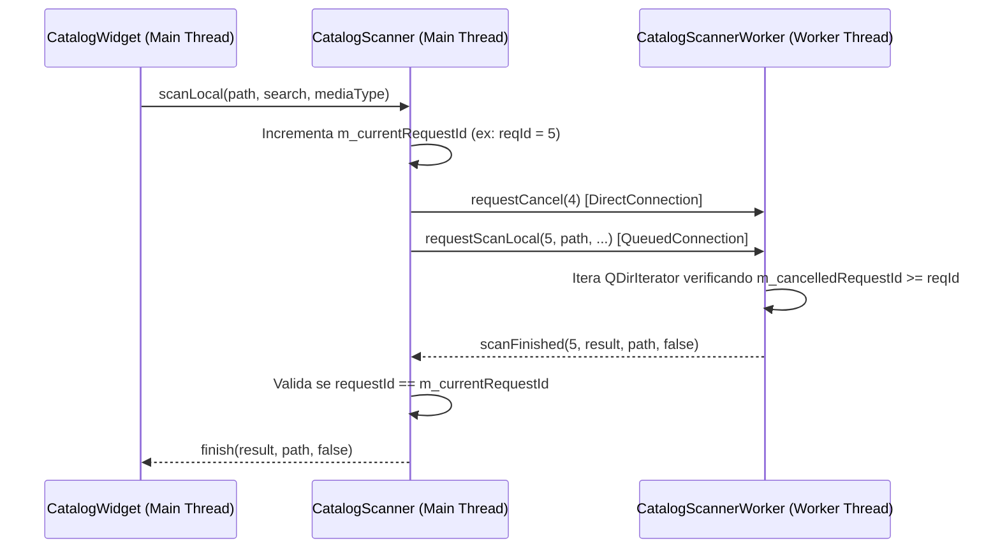

# Módulo de Catálogo de Mídia

O módulo de **Catálogo** permite ao operador navegar rapidamente pelas pastas do acervo da emissora (divididas por categoria), realizar buscas instantâneas locais ou globais em segundo plano e arrastar mídias diretamente para a Playlist ou para a Cartucheira.

---

## 🗂️ Organização de Pastas e `catalog.json`

O arquivo `data/catalog.json` (sincronizado com o `NaxServer` ou mantido localmente) contém um array JSON com as pastas cadastradas:

```json
[
  {
    "id": "folder-uuid-01",
    "title": "Vinhetas Padrão",
    "path": "D:/Acervo/Vinhetas",
    "type": 0
  },
  {
    "id": "folder-uuid-02",
    "title": "Pop Internacional",
    "path": "D:/Acervo/Musicas/Pop",
    "type": 1
  }
]
```

Ao carregar esse arquivo, o `FolderListModel::loadFromDatabase()` agrupa automaticamente as pastas por `MediaType` na seguinte ordem padrão:
1. **Vinhetas** (`type = 0 / MediaType::Jingle`)
2. **Músicas** (`type = 1 / MediaType::Music`)
3. **Comerciais** (`type = 2 / MediaType::Commercial`)
4. **Outros** (`type = 3 / MediaType::Other`)

Para cada grupo não vazio, o modelo insere um item do tipo `FolderItemType::CategoryHeader` (não selecionável) seguido pelas pastas daquela categoria.

### Itens de Comando no Catálogo

Além das pastas de arquivos de áudio, o Catálogo disponibiliza itens especiais do tipo **Comando**, que podem ser arrastados diretamente para dentro dos blocos da Playlist. Um comando não é necessariamente uma mídia sonora, mas sim uma instrução executada quando a playlist chega naquela posição:
- **Pausa**: Pausa a reprodução automática da playlist naquele ponto, aguardando o comando `Next` do operador para prosseguir.
- **Hora Certa**: Dispara a locução correspondente ao horário exato no momento da execução.
- **Comandos do OBS Studio**: Enviam sinais via WebSocket para o OBS Studio (como alternar cenas ou fontes) no instante em que a programação atinge o item.

---

## ⚡ Escaneamento Multithread e Cancelamento Lock-Free (`CatalogScanner`)

Pastas de rádio frequentemente contêm milhares de arquivos de áudio (`.mp3`, `.wav`, `.opus`, `.aac`, `.flac`, `.webm`, `.m4a`, `.ogg`, `.wma`), muitas vezes em unidades de rede. Escanear o sistema de arquivos na thread principal travaria a interface e o cronômetro.

Por isso, o `CatalogScanner` utiliza um `CatalogScannerWorker` movido para uma `QThread` dedicada (`m_workerThread`):



### Mecanismo de Cancelamento Lock-Free e Proteção contra *Race Conditions*

Quando o operador alterna rapidamente entre pastas (ex.: clica na Pasta A e, 50 ms depois, na Pasta B) ou digita rápido na busca global, a varredura anterior precisa ser abortada imediatamente sem bloquear a GUI e sem risco de resultados atrasados da Pasta A sobrescreverem a Pasta B na tela:

1. **ID de Requisição Monotônico (`m_currentRequestId`)**: A cada chamada de `scanLocal()` ou `scanGlobal()`, o `CatalogScanner` cancela a requisição anterior e incrementa atomicamente `m_currentRequestId`.
2. **Cancelamento Imediato Lock-Free (`m_cancelledRequestId`)**: O sinal `requestCancel(current)` é conectado ao slot `CatalogScannerWorker::cancel()` via `Qt::DirectConnection`, gravando o ID cancelado em um `QAtomicInt` com semântica `storeRelease()` instantaneamente, sem `QMutex` ou bloqueios de thread. A cada arquivo iterado no `QDirIterator`, o worker verifica `m_cancelledRequestId.loadAcquire() >= requestId` e retorna imediatamente se a busca tiver sido substituída.
3. **Descarte Seguro na Recepção (`onScanFinished`)**: Quando `scanFinished` retorna à thread principal via `Qt::QueuedConnection`, `onScanFinished` compara `requestId == m_currentRequestId.loadAcquire()`, descartando qualquer resultado obsoleto.

### Modos de Busca
1. **Busca Local (`scanLocal`)**:
   - Escaneia apenas a pasta atualmente selecionada (`m_openFolder`), filtrando pelo texto digitado em `SearchLine` (ou listando tudo se a busca estiver vazia) e ordenando alfabeticamente (`Qt::CaseInsensitive`).
   - Ativa `setUniformItemSizes(true)` na `FilesListView` para máxima performance de layout.
2. **Busca Global (`scanGlobal`)**:
   - Percorre todas as pastas cadastradas no catálogo.
   - Para cada pasta que contenha arquivos correspondentes ao termo buscado, insere um `CatalogItemType::FolderHeader` com o nome da pasta seguido pelos arquivos ordenados.
   - Desativa `setUniformItemSizes(false)` pois cabeçalhos (34px) e arquivos (35px) possuem alturas distintas.

---

## 🧲 protocolo de Drag-and-Drop (`application/x-catalog-item`)

Quando o usuário arrasta um arquivo da `FilesListView`, o método `CatalogListModel::mimeData()` empacota os dados do item usando `QDataStream` no formato binário `"application/x-catalog-item"`:

```cpp
QByteArray data;
QDataStream stream(&data, QIODevice::WriteOnly);
stream << item.title << item.path << item.rawMediaType();
mime->setData("application/x-catalog-item", data);
```

Tanto a **Cartucheira (`CartWallView`)** quanto a **Playlist (`PlaylistView`)** leem esse stream para criar o item correspondente com o título, caminho e cor/ícone da categoria correta.

