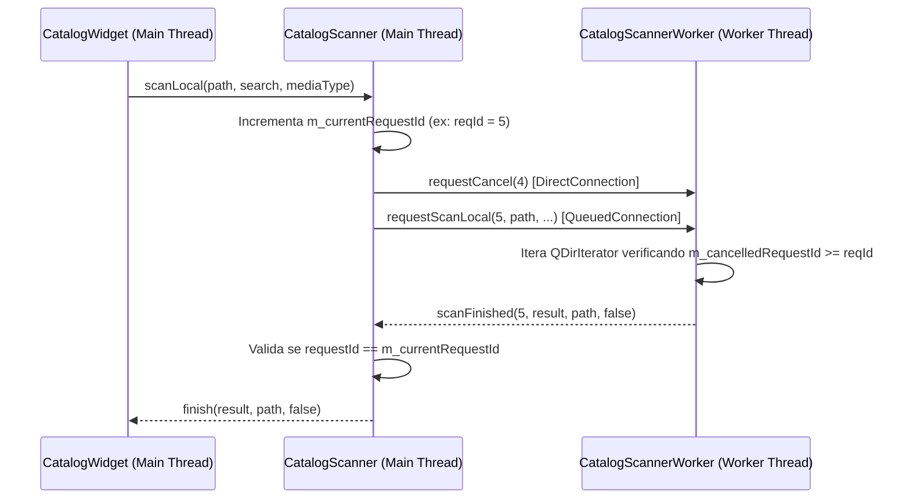

# Módulo de Catálogo de Mídia

O módulo de **Catálogo** permite ao operador navegar rapidamente pelas pastas do acervo da emissora (divididas por categoria), realizar buscas instantâneas locais ou globais em segundo plano e arrastar mídias diretamente para a Playlist ou para a Cartucheira.

---

## 🗂️ Organização de Pastas e `catalog.json`

O arquivo `data/catalog.json` (sincronizado com o `NaxServer` ou mantido localmente) contém um objeto raiz com `version` e um array `folders` com as pastas cadastradas:

```json
{
  "version": 1,
  "folders": [
    {
      "id": "folder-uuid-01",
      "title": "Vinhetas Padrão",
      "type": "jingle",
      "path": "D:/Acervo/Vinhetas"
    },
    {
      "id": "folder-uuid-02",
      "title": "Pop Internacional",
      "type": "music",
      "path": "D:/Acervo/Musicas/Pop"
    }
  ]
}
```

Ao carregar esse arquivo, o `FolderListModel::loadFromDatabase()` agrupa automaticamente as pastas por `MediaType` na seguinte ordem padrão:
1. **Comandos** (`"type": "command"` / `MediaType::Command`)
2. **Vinhetas** (`"type": "jingle"` / `MediaType::Jingle`)
3. **Músicas** (`"type": "music"` / `MediaType::Music`)
4. **Comerciais** (`"type": "commercial"` / `MediaType::Commercial`)
5. **Outros** (`"type": "other"` / `MediaType::Other`)

Para cada grupo não vazio, o modelo insere um item do tipo `FolderItemType::CategoryHeader` (não selecionável) seguido pelas pastas daquela categoria.

### Itens de Comando no Catálogo

Além das pastas de arquivos de áudio em disco, o Catálogo suporta pastas virtuais da categoria **Comandos** (`"type": "command"` / `MediaType::Command`) definidas diretamente dentro de `data/catalog.json` — sem necessidade de diretório físico no disco (o campo `"path"` é opcional e pode ser omitido). Os comandos dessa "pasta" são declarados no próprio array `"items"` do objeto da pasta no JSON:

```json
{
  "id": "comandos-playlist",
  "title": "Playlist",
  "type": "command",
  "items": [
    {
      "id": "pause",
      "title": "Pausar Playlist",
      "command": "pause"
    }
  ]
}
```

Cada item de comando pode ser buscado normalmente (tanto na busca local quanto na busca global) e arrastado diretamente para dentro dos blocos da Playlist. Um comando não é uma mídia sonora, mas sim uma instrução executada quando a playlist chega naquela posição:
- **Pausa (`"command": "pause"`)**: Interrompe a reprodução automática da playlist naquele ponto (equivalente a um `Stop`), deixando o próximo item pronto como `PRÓXIMO` até que o operador pressione `Play` (ou `Next`).
- **Hora Certa** *(planejado)*: Dispara a locução correspondente ao horário exato no momento da execução.
- **Comandos do OBS Studio** *(planejado)*: Enviam sinais via WebSocket para o OBS Studio (como alternar cenas ou fontes) no instante em que a programação atingem o item.

---

## ⚡ Escaneamento Multithread e Cancelamento Lock-Free (`CatalogScanner`)

Pastas de rádio frequentemente contêm milhares de arquivos de áudio (`.mp3`, `.wav`, `.opus`, `.aac`, `.flac`, `.webm`, `.m4a`, `.ogg`, `.wma`), muitas vezes em unidades de rede. Escanear o sistema de arquivos na thread principal travaria a interface e o cronômetro.

Por isso, o `CatalogScanner` utiliza um `CatalogScannerWorker` movido para uma `QThread` dedicada (`m_workerThread`):



### Mecanismo de Cancelamento Lock-Free e Proteção contra *Race Conditions*

Quando o operador alterna rapidamente entre pastas (ex.: clica na Pasta A e, 50 ms depois, na Pasta B) ou digita rápido na busca global, a varredura anterior precisa ser abortada imediatamente sem bloquear a GUI e sem risco de resultados atrasados da Pasta A sobrescreverem a Pasta B na tela:

1. **ID de Requisição Monotônico (`m_currentRequestId`)**: A cada chamada de `scanLocal()` ou `scanGlobal()`, o `CatalogScanner` cancela a requisição anterior e incrementa atomicamente `m_currentRequestId`.
2. **Cancelamento Imediato Lock-Free (`m_cancelledRequestId`)**: O sinal `requestCancel(current)` é conectado ao slot `CatalogScannerWorker::cancel()` via `Qt::DirectConnection`, gravando o ID cancelado em um `QAtomicInt` com semântica `storeRelease()` instantaneamente, sem `QMutex` ou bloqueios de thread. A cada arquivo iterado no `QDirIterator`, o worker verifica `m_cancelledRequestId.loadAcquire() >= requestId` e retorna imediatamente se a busca tiver sido substituída.
3. **Descarte Seguro na Recepção (`onScanFinished`)**: Quando `scanFinished` retorna à thread principal via `Qt::QueuedConnection`, `onScanFinished` compara `requestId == m_currentRequestId.loadAcquire()`, descartando qualquer resultado obsoleto.

### Modos de Busca
1. **Busca Local (`scanLocal`)**:
   - Escaneia apenas a pasta atualmente selecionada (`m_openFolder`), filtrando pelo texto digitado em `SearchLine` (ou listando tudo se a busca estiver vazia) e ordenando alfabeticamente (`Qt::CaseInsensitive`).
   - Ativa `setUniformItemSizes(true)` na `FilesListView` para máxima performance de layout.
2. **Busca Global (`scanGlobal`)**:
   - Percorre todas as pastas cadastradas no catálogo.
   - Para cada pasta que contenha arquivos correspondentes ao termo buscado, insere um `CatalogItemType::FolderHeader` com o nome da pasta seguido pelos arquivos ordenados.
   - Desativa `setUniformItemSizes(false)` pois cabeçalhos (34px) e arquivos (35px) possuem alturas distintas.

---

## 🧲 protocolo de Drag-and-Drop (`application/x-catalog-item`)

Quando o usuário arrasta um arquivo da `FilesListView`, o método `CatalogListModel::mimeData()` empacota os dados do item usando `QDataStream` no formato binário `"application/x-catalog-item"`:

```cpp
QByteArray data;
QDataStream stream(&data, QIODevice::WriteOnly);
stream << item.title << item.path << item.rawMediaType() << item.durationMs
       << static_cast<qint8>(item.itemType)
       << static_cast<qint8>(item.commandType) << item.commandId;
mime->setData("application/x-catalog-item", data);
```

A **Playlist (`PlaylistView`)** aceita tanto arquivos de áudio quanto itens de Comando, enquanto a **Cartucheira (`CartWallView`)** aceita apenas arquivos de áudio (rejeitando itens com `MediaType::Command`).

