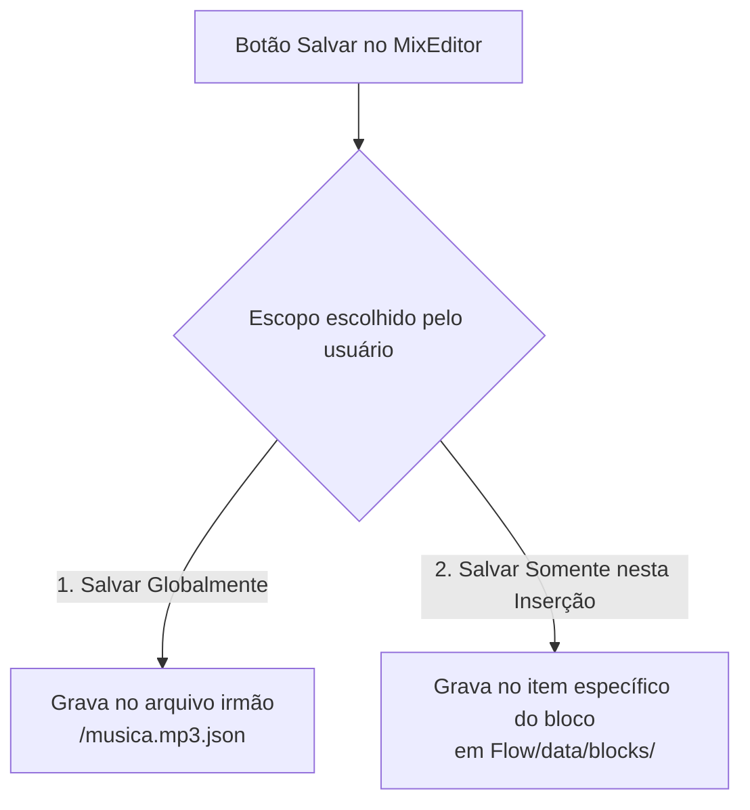

# Módulo do Editor de Mixagem (MixEditor)

O **Editor de Mixagem (`MixEditor`)** é a ferramenta integrada ao **NaxStudio Flow** para definir com precisão de milissegundos o comportamento de corte, sobreposição (*crossfade*) e automação de volume de qualquer faixa de áudio.

---

## 🚀 Como o Editor é Acionado

O `MixEditor` pode ser aberto através do **menu de contexto (botão direito do mouse)** em dois locais:
1. **No Catálogo (`CatalogWidget`)**: Abre o arquivo de áudio selecionado para edição de seus metadados globais.
2. **Na Playlist (`PlaylistView`)**: Abre o item de mídia selecionado na programação, permitindo tanto editar seus metadados globais quanto criar uma mixagem exclusiva para aquela inserção na playlist.

Toda a reprodução de teste dentro do `MixEditor` (botões `Play`, `Pause`, `Stop`) é enviada para a **Placa de Som de Pré-escuta (CUE)**, permitindo que o operador ajuste pontos de mixagem mesmo enquanto a rádio está transmitindo normalmente no ar.

---

## 📊 Visualização de Forma de Onda (*Waveform*) e Pontos de Marcação

O `MixEditor` exibe a **forma de onda (*waveform*)** do áudio acompanhada dos controles numéricos de tempo (`mm:ss:zzz`) e sliders de volume. O operador pode definir os pontos diretamente sobre o gráfico da forma de onda ou nos campos de tempo:

| Parâmetro | Controle na UI (`MixEditor.ui`) | Função na Reprodução |
| :--- | :--- | :--- |
| **Ponto Inicial (`startPoint`)** | Marcador na Waveform | Posição exata onde o áudio começa a tocar (ignora silêncio inicial). |
| **Ponto Final (`endPoint`)** | Marcador na Waveform | Posição onde a reprodução da faixa é encerrada definitivamente. |
| **Mixagem Inicial (`mixStart`)** | `timeMixStart` + Marcador | Ponto que ficará sincronizado exatamente com o `mixEnd` da faixa anterior (o áudio inicia antes, em `startPoint`, para atingir `mixStart` no instante em que a anterior atinge `mixEnd`). |
| **Mixagem Final (`mixEnd`)** | `timeMixEnd` + Marcador | Ponto de referência final que será alinhado com o `mixStart` da próxima faixa da playlist. |
| **Fim do Fade In (`fadeInEndPoint`)** | `timeFadeIn` + Marcador | Instante em que a curva de *Fade In* atinge 100% do volume alvo. |
| **Início do Fade Out (`fadeOutStartPoint`)** | `timeFadeOut` + Marcador | Instante em que se inicia a curva de *Fade Out* até `endPoint`. |
| **Volume Inicial / Final** | `sliderVolStart` / `sliderVolEnd` | Níveis de volume aplicados nos extremos de entrada e saída. |
| **Envelope Intermediário de Volume** | `timeEdit_4`, `timeEdit_5`, `timeEdit_6`, `timeEdit_7` | Pontos de início/fim de aumento e início/fim de diminuição de volume (ex.: abaixar a introdução da música para entrada de locução ou carimbo). |

---

## 💾 Modalidades de Salvamento (Global vs. Inserção Local)

Ao clicar em **Salvar (`btnSave`)**, o `MixEditor` oferece duas opções de persistência:

1. **Salvar Globalmente (`musica.mp3.json`)**:
   - Cria ou atualiza o arquivo JSON irmão na mesma pasta do arquivo de áudio (ex.: `D:/Acervo/Musicas/musica.mp3.json`).
   - Todas as vezes que essa música for carregada no futuro (seja na playlist ou na cartucheira), ela utilizará automaticamente esses pontos.
2. **Salvar Somente para Esta Inserção**:
   - Disponível quando o `MixEditor` é aberto a partir de um item da **Playlist**.
   - Salva os pontos apenas nos metadados daquela inserção dentro do bloco local do Flow, sem alterar o arquivo global `musica.mp3.json`.
   - Ideal quando o locutor precisa de um corte ou fade específico apenas para encaixar o tempo daquele bloco.

